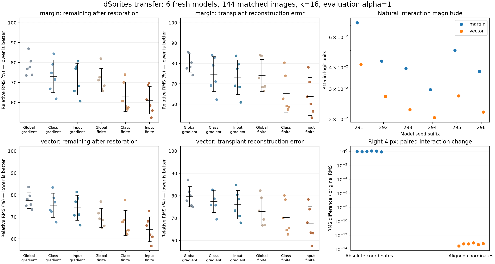

# Cross-layer Interaction Study

**神经元组合效应与跨层中介机制的受控研究**

Research code for conditional neuron interactions, layer-wise nonlinear decomposition, held-condition prediction, and blocking/keep interventions in small residual CNNs. Experiments cover Fashion-MNIST and a controlled dSprites shape-classification subset. Chinese comments and reading guides are included.

本项目把“层与层之间有什么关系”具体化为：**前层单元的组合干预产生哪些非加性效应，后层哪些状态能够阻断或重现这些效应，这些状态是否随输入因素而变化？**

当前是探索性研究。计算核验支持交互定义、逐层分解和修补实现；现有结果尚不支持“已找到紧凑、稳定且充分的语义回路”。仓库名是研究方向名称，尚非定稿论文标题。

最新实验于 2026 年 11 月 1 日完成。它在 36 张 dSprites 图像中按大小和角度留出条件，先冻结组合规则，再预测三组共同变化时的 block2 响应、输出及阻断效应。中间层预测通过预设判据，另外三项未通过。[最新实验说明](docs/LATEST_EXPERIMENT.md)

## 完整复跑最新实验

下载或克隆本仓库，在仓库根目录使用 Python 3.12 的虚拟环境运行：

```bash
python -m pip install -r reproduction/held_condition/requirements.txt
python -B -X utf8 reproduce_latest.py
```

数据已随仓库发布：[六个模型权重](reproduction/held_condition/runs/dsprites_20260929)、[36 张原图与配对信息](reproduction/held_condition/runs/dsprites_shape_donor_20261010/panel/data.npz)、[冻结记录](reproduction/held_condition/reference)。入口会重新拟合、预测、测量两种干预强度、执行独立核验并生成报告。每次运行使用新的 `local_output/held-condition-*/` 目录，最终的 `comparison.json` 给出与原记录的对照结果。默认自动选择设备，可传 `--device cpu`。[复跑说明](docs/REPRODUCTION.md)

## 先运行一个例子

Python 3.11+；在仓库根目录执行：

```bash
python -m pip install -r requirements-demo.txt
python -B run_dsprites_demo.py
python -B run_demo.py
python -B check_repository.py
```

- `run_dsprites_demo.py`：重算三张 dSprites 输入的真实缓存输出，展示条件交互、恢复和移植评分。
- `run_demo.py`：用四张 Fashion 输入的真实缓存响应演示单独／成对预测与高阶残差。
- `check_repository.py`：检查发布文件的 SHA-256 与所有 Python 文件的语法；仅需标准库。

两套示例都不下载数据、不训练模型、无需 GPU。它们是历史响应的计算演示，不能替代六个模型的完整实验。

需要检查核心实现与原网络前向的一致性时：

```bash
python -m pip install -r requirements.txt
python -B run_checks.py
```

该检查使用已知答案及固定随机网络，**不读取本机原实验目录**。不要使用 `python -O`，因为研究代码通过断言执行数值核验。

## 代码和方法从哪里读

| 入口 | 内容 |
|---|---|
| [代码阅读指南](docs/CODE_GUIDE.md) | 从研究问题、公式到具体函数 |
| [复现范围和运行顺序](docs/REPRODUCTION.md) | 可立即运行的检查、完整实验所需档案、已知限制 |
| [全部源码索引](docs/SCRIPT_INDEX.md) | 178 个研究源码文件的用途 |
| [最新判别实验](docs/LATEST_EXPERIMENT.md) | 固定组合规则、留出条件预测、二阶基线与通道阻断 |
| [研究逻辑](source/reports/dSprites_研究逻辑与复用边界_2026-09-29.md) | 原设想如何变成可证伪的跨层机制问题 |
| [dSprites 再评估报告](source/reports/dSprites_旧研究再评估_2026-09-29.md) | 当前结果、失败边界和下一步问题 |
| [数值附表](source/reports/dSprites_逐项结果表_2026-09-29.md) | 各目标、预算、强度和模型的结果 |
| [发布来源记录](PROVENANCE.json) | 原始源码与注释／公开副本的对应哈希 |

## 早期 dSprites 实验（2026 年 9 月 29 日）

使用原生 64×64 二值图像，训练六个新初始化的三类小残差 CNN。训练／验证为 24,576／3,072 张；开发与评价面板各 144 条因素记录。评价固定中心位置，匹配形状、大小和角度，另设严格右移 4 像素的配对控制。

源为 block1 的四个空间标量，枚举 16 个干预组合、24 个条件成对差分；中介位于 block2。比较全局固定、类别固定和逐图选择，加入梯度、实际单点修补、随机、完整候选池等控制。

主设置：共同 64 候选、16 个中介、α=1、真实类 margin、实际单点评分。下面为六模型均值，两个指标均越低越好：

| 选择方式 | 恢复后剩余交互 | 移植重建误差 |
|---|---:|---:|
| 全局固定 | 71.20% | 74.07% |
| 类别固定 | 62.88% | 65.34% |
| 逐图选择 | 61.16% | 63.81% |

类别条件解释了相当一部分优势；逐图额外收益依赖评价目标和干预强度。12,960 次主面板非空源干预未改变预测类别，因此这里的证据针对 **logit 中的组合效应**，尚未证明分类决策依赖这些源点。完整说明和不确定性见报告。



## 发布范围

本仓库包含研究源码、中文注释、方法说明、真实响应示例，以及最新判别实验所需的全部模型、图像和核验输入。较早阶段的完整训练集、大型输出数组与历史交付档案由原项目单独保存。

`source/` 保留原项目的相对目录关系。历史完整实验入口依赖当时的数据、模型和冻结清单，**当前版本不是一键恢复全部历史实验的发行包**。不要把逐个执行所有脚本当成复现流程；详见 [REPRODUCTION.md](docs/REPRODUCTION.md)。

公开副本保留技术注释，并将少数本机专用路径替换为相对占位路径。来源记录逐文件列出原始和发布哈希，以及文档字符串和路径调整造成的语法树差异。完整实验的冻结原件独立保存。

第三方数据来源与许可见 [THIRD_PARTY.md](THIRD_PARTY.md)。本次未为原创项目代码指定开源许可证；数据集附带许可证不代表本仓库整体采用该许可证。
