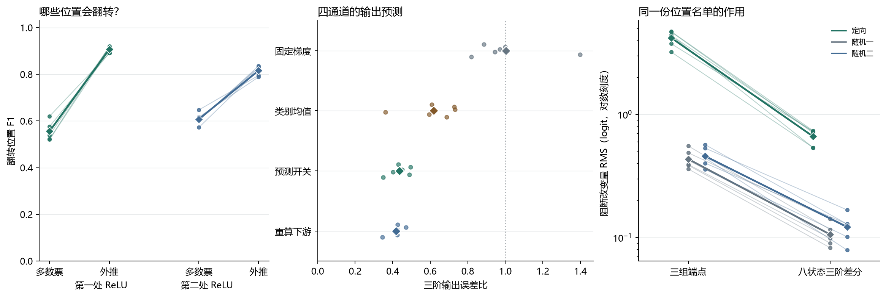

# 从三组源通道预测下游 ReLU 开关和输出

2026 年 11 月 25 日 · dSprites · 36 张图像 · 6 个冻结残差卷积网络

只观察空组、三个单组和三个双组，就可以预报三组共同替换时下游两处 ReLU 的许多翻转。全强度下，四通道中间层预测配合预测开关，最终三阶输出的误差比为 **0.4355**，同一中间预测经过原下游网络得到 **0.4175**。预先选中的位置对输出得分有较大作用。把相同位置锁回空组开关后，六个模型的三阶联合响应均减弱，平均剩余量为原 RMS 的 **91.14%**。

## 组合、开关和输出

同大小、角度和位置的两种形状构成供体与受体。将受体 block1 的 16 个通道分为四组，每组四个整通道。每次选三组换入供体激活。留出集有 6 个大小 × 角度条件、18 张图和 18 个定向配对，每对有 4 种三组组合。每种强度共 432 个模型／配对／组合记录。此面板在前期已用于机制探索。本轮沿用 18 张开发图上确定的通道名单和配对方向。

令 F 为供体类别减受体类别的 logit。对任意中间量或输出 X，以 QX 表示七个低阶子集给出的二阶估计，三阶作用为 X(ABC) − QX。

```text
QX = X(AB) + X(AC) + X(BC) − X(A) − X(B) − X(C) + X(空)
```

在 block3 的每一处 ReLU，对低阶状态的预激活 z 计算 Qz，大于零即预测开启。在同一预测中间场上，分别用预测开关或原网络自然算出的开关传递数值，保留卷积、残差支路和分类头。首先保存 864 份逐例预测及全部阻断名单，再运行真正的三组端点。全强度为主检验，半强度复用同一规则。[主实验设计](../experiments/gate_forecast_20261125/DESIGN.md) · [预测封存](../runs/dsprites_gate_forecast_20261125/prediction_seal.json)

## 哪些开关可以预报

翻转是同一位置相对空组改变开启或关闭状态。精确率是预测翻转中实际翻转的比例，召回率是实际翻转中被找回的比例，F1 是二者的调和平均。表中先在各模型内汇总位置，再等权平均六个模型。

| 全强度 | 外推精确率 | 外推召回率 | 外推 F1 | 多数票精确率 | 多数票召回率 | 多数票 F1 |
| --- | ---: | ---: | ---: | ---: | ---: | ---: |
| 第一处 ReLU | 0.912 | 0.901 | **0.907** | 0.947 | 0.395 | 0.556 |
| 第二处 ReLU | 0.828 | 0.804 | **0.816** | 0.906 | 0.458 | 0.608 |

两层 F1 在六个模型上均提高。多数票预测的翻转更少，精确率较高。预激活外推找回了更多真实翻转。半强度两层外推 F1 分别为 0.928 和 0.882。[逐模型及开启／关闭方向](../runs/dsprites_gate_forecast_20261125/gate_scores.csv)

## 这些开关能预测多少输出

误差比为模型内 RMS(预测三阶作用 − 实测三阶作用) / RMS(实测三阶作用)，再等权平均。预测三阶作用为零时该值为 1。四通道指 block2 输出中接受三阶修正的通道数，全部 32 个通道都有低阶估计。

| 中间通道数及下游处理 | 全强度误差比 | 半强度误差比 |
| --- | ---: | ---: |
| 开发格的形状转换 × 三组编号均值 | 0.6185 | 1.9332 |
| 4 通道，空组梯度 | 1.0031 | 0.9868 |
| 4 通道，七状态开关多数票 | 1.2540 | 1.9288 |
| 0 通道修正，预报两处开关 | 0.4672 | 0.6193 |
| **4 通道，预报两处开关** | **0.4355** | **0.5558** |
| 4 通道，原网络重算开关 | 0.4175 | 0.5380 |
| 32 通道，预报两处开关 | 0.3861 | 0.4012 |
| 32 通道，原网络重算开关 | 0.3056 | 0.3467 |

全强度四通道方案相对固定梯度改善 0.5676，六个模型均改善。相对类别均值改善 0.1830，有五个模型改善，两项均达到事前的 0.05 和至少四个模型的判据。输出三阶作用的方向命中 375/432。同样使用预测开关时，从零通道修正到四通道修正，误差比降低 0.0317。由四通道扩到全部 32 个通道后，预测开关与重算开关之间的误差比差距从 0.0179 扩为 0.0806。[全部预算与逐模型成绩](../runs/dsprites_gate_forecast_20261125/teacher_scores.csv)



圆点代表单个模型，菱形代表六模型均值。右图的端点和八状态差分使用相同的位置和阻断操作。

## 哪些位置对得分有作用

在两处 ReLU 各自预测翻转的位置中，按预激活和下游有符号读出系数挑选最多 64 个点。每个案例单独给出名单。另从同一候选池抽两组对照，逐层匹配点数和开启／关闭数量。对选中位置用空组开关乘以当前预激活，卷积与残差支路照常传播。这个操作可以将原先开启的数值置零，也可以让原先关闭的负预激活通过。正的干预差表示恢复开关后供体相对得分提高。

| 全强度定向阻断 | 端点得分改变量 RMS（logit） | 随机一／随机二 RMS | 定向改变量预测误差比 | 方向命中 |
| --- | ---: | ---: | ---: | ---: |
| 第一处 | 4.091 | 0.369 / 0.396 | 0.118 | 421/432 |
| 第二处 | 0.848 | 0.135 / 0.134 | 0.080 | 427/432 |
| 两处同时 | **4.187** | **0.434 / 0.458** | **0.119** | **417/432** |

定向联合阻断的实测 RMS 在六个模型上均高于匹配随机对照的平均值。定向位置实际翻转的比例，第一处为 99.57%，第二处为 97.11%。两处单独阻断的效应在 144/432 个案例中方向相反。联合阻断与两层单独效应之和的差异 RMS 为 0.377 logit。半强度联合阻断 RMS 为 2.414 logit，方向命中 429/432。[逐例端点干预](../runs/dsprites_gate_forecast_20261125/interventions.csv) · [逐模型结果](../runs/dsprites_gate_forecast_20261125/intervention_scores.csv)

## 扣除低阶作用后还剩多少

在得到主实验汇总后，用同一份冻结名单追加八状态对照。对每个子集 S 都锁相同位置，记 e(S) 为阻断后减阻断前的得分。上表测量三组端点 e(ABC)。对八个状态取同一个三阶差分，得到这些位置的阻断真正改变的联合效应 e(ABC) − Qe。预测和实测在此共用七个实际低阶干预值，因此需要额外的低阶阻断前向。[八状态方案](../experiments/gate_forecast_20261125/EIGHT_CORNERS.md)

| 全强度两处同时阻断 | 三阶改变量 RMS（logit） | 阻断后的三阶 RMS / 原 RMS | 三阶改变量方向命中 |
| --- | ---: | ---: | ---: |
| 定向 64 点／层 | **0.661** | **0.9114** | **364/432** |
| 随机一 | 0.106 | 0.9911 | 334/432 |
| 随机二 | 0.121 | 0.9857 | 352/432 |

定向名单使六个模型的三阶 RMS 均下降。单看案例，276/432 的三阶幅度变小。端点得分改变量和三阶改变量在 **208/432** 个案例中符号相反。半强度的定向三阶改变量为 0.334 logit，阻断后剩余三阶 RMS 比为 0.8682，六个模型均下降。两种强度上，这些开关都传递了可测的一部分联合效应。干预后，网络仍保留了大部分三阶响应。[八状态逐例表](../runs/dsprites_gate_forecast_20261125/eight_corners/measurements.csv) · [逐模型八状态成绩](../runs/dsprites_gate_forecast_20261125/eight_corners/teacher_scores.csv)

## 一个案例的两个方向

按协议顺序的首个全强度案例为模型 202609291、配对 6、三组掩码 7。第一处排名首位的位置为（通道 16，行 15，列 16），第二处为（31，16，13）。两个位置都从关闭变为开启。原输出三阶作用为 −0.0499，四通道开关规则预测 −0.0382。

将两份定向名单恢复到空组开关，三组端点的实测得分下降 **0.8971** logit，预测下降 **1.2220**。七个低阶干预的二阶估计则为 −1.4349，因此相同干预使三阶作用**增加 0.5377** logit，预测增加 0.2129。这个例子展示了同一份位置名单怎样同时降低端点得分、提高其中的三阶分量。[逐例端点预测](../runs/dsprites_gate_forecast_20261125/intervention_predictions.csv) · [低阶干预记录](../runs/dsprites_gate_forecast_20261125/eight_corners/low_corner_effects.csv)

## 复跑

两轮运行覆盖相同的 864 个模型／强度／配对／组合记录。GPU 批量改写掩码，CPU 从图像和权重重新计算，在原 ReLU 输出中逐名单改写位置。两次得到的开关、点号和翻转计数完全一致。两轮共比对 7,776 个端点干预、54,432 个低阶干预和 7,776 个八状态差分，13 张结果表的最大数值差为 1.80 × 10⁻¹³。独立实现以子集奇偶重算外推、用自动微分核对 1,728 份定向名单。11 月 10 日实验的预测、实测、模型成绩和抵消记录也已从公开输入复现，四个 CSV 文件逐字节一致。[复现命令](../experiments/gate_forecast_20261125/README.md) · [核对记录](../runs/dsprites_gate_forecast_20261125/replay_comparison.json)
