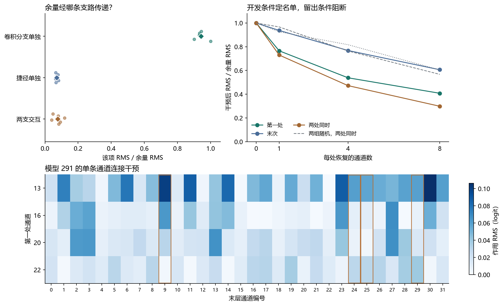

# 两处各锁 64 个 ReLU 后，剩余的三阶效应经哪里传到输出？

2026 年 11 月 26 日 · dSprites · 36 张图像 · 六个独立初始化的冻结模型

上轮把最后一个残差块两处各 64 个 ReLU 位置的开关固定为空组状态，三阶输出的均方根（RMS）仍保留原来的 **91.14%**。本轮从这份余量出发进行实际干预。主要通路经过最后一个残差块的**卷积分支**。前一处 ReLU 中少数通道的变化可同时影响多个末层通道。将两处各自预选的 4 个通道固定到空组激活，余量降至 **47.25%**，折合原始三阶输出的 **42.97%**。两个同预算随机对照分别留下余量的 **76.42% 和 81.72%**。[逐模型记录](../runs/dsprites_remaining_routes_20261126/budget_scores.csv)

## 从哪个量开始追踪

模型有三个残差块。在第一块输出替换三个通道组，读出“供体形状得分减受体形状得分”。对于每个三组，都运行空组、三个单组、三个双组和三组全选共八个状态。三阶输出等于三组全选得分减去七个低阶状态给出的二阶预测。它衡量三组共同改变时额外产生的得分差，单位为 logit。

沿用原来的大小与角度划分，每个模型有 18 个开发配对、18 个留出配对，每对各测 4 个三组。六个模型每种强度共 432 条，每个模型的 RMS、比值或投影先分别计算，再对模型等权平均。这里“余量”专指八个状态都锁住原 64 个位置后得到的三阶输出，记作 Y。本轮的通道名单只使用开发条件确定。留出条件沿用 11 月 25 日的实验面板。[上轮结果](dSprites_三组通道的开关预测与八状态阻断_2026-11-25.md) · [本轮设计与公式](../experiments/remaining_routes_20261126/DESIGN.md)

## 余量主要经过卷积分支

末块把卷积分支与捷径相加，再经过末次 ReLU、全局平均池化和分类头。将其中一条支路固定为空组输入、让另一条随八个状态变化，每次均重算末次 ReLU。在全强度下，原始输出 RMS 为 3.267 logit，旧开关阻断后的余量 RMS 为 3.007 logit。

| 八状态干预或差分项 | RMS（logit） | 相对余量的 RMS | 对余量的有符号投影 |
|---|---:|---:|---:|
| 只让卷积分支变化 | 2.837 | 94.20% | 93.81% |
| 只让捷径变化 | 0.208 | 7.05% | 4.46% |
| 两条支路在末次开关汇合的交互 | 0.204 | 7.71% | 1.73% |

三项按符号逐例相加，正好得到 Y。有符号投影为 Σ(该项 × Y) / ΣY²，所以三项投影相加为 100%。全强度 432 条中有 122 条卷积分支与捷径单独作用反号。半强度下卷积分支单独的 RMS 仍为余量的 93.75%。[两种强度的支路和开关分解](../runs/dsprites_remaining_routes_20261126/components.csv)

另外把末块的**全部开关**固定为空组状态，保留每个位置随输入变化的幅值，全强度下仍剩余量 RMS 的 **56.83%**。这部分可用空组输出梯度乘以前一块送来的真实三阶激活重建。只允许第一处未锁定的开关自由变化时保留 87.31%，只允许末次未锁定开关自由变化时保留 65.96%。因此末块既传递进入它时已有的三阶信号，也通过改变开关来调整这份信号。[仿射重建及支路核对](../runs/dsprites_remaining_routes_20261126/checks.json)

## 哪几个通道最能改变余量

在开发条件上依次把一个整通道的激活图恢复为同一配对的空组值，按它使三阶输出平方平均减少多少来排序。每个模型、每处 ReLU 各自冻结名单，并冻结两组随机排列。留出端分别测试只恢复第一处、只恢复末次、两处同时恢复。此前的 64 点操作固定开关的开闭，这里的整通道操作固定开关后的激活幅值。两者覆盖的位置和改变的量均有区别。

| 实际恢复的通道 | 全强度，剩余 / 余量 | 半强度，剩余 / 余量 |
|---|---:|---:|
| 只恢复第一处 4 个 | 53.85% | 57.76% |
| 只恢复末次 4 个 | 76.83% | 78.85% |
| 两处各恢复 4 个 | **47.25%** | **50.59%** |
| 随机对照一，两处各 4 个 | 76.42% | 77.95% |
| 随机对照二，两处各 4 个 | 81.72% | 80.54% |
| 两处各恢复 8 个 | **29.88%** | **32.33%** |

主预算为每处 4 个，两种强度下定向干预在六个模型中均比两组随机对照的均值留下更小的 RMS。全强度中 330/432 条记录的绝对余量缩小，半强度为 318/432。单独恢复末次排名第一的通道，全强度仍余 93.74%，相比随机单通道的改善未达到预定的 5 个百分点。整通道核对也给出了两个边界结果，恢复第一处全部 32 个通道等价于只让捷径变化，恢复末次全部 32 个通道时三阶输出归零。[通道预算与随机对照](../runs/dsprites_remaining_routes_20261126/budget_scores.csv)

图左上每个小点代表一个模型，菱形为六模型均值。右上两条灰线为两组同预算随机干预。下方以模型 291 为例，每个格子是单独替换第一处某通道送往一个末层通道的信号后，三阶得分改变量的 RMS。橙框标出开发端选定的末层四通道。

| 模型种子末三位 | 第一处前 4 个通道 | 末次前 4 个通道 | 两处各恢复 4 个后的余量 | 留出端作用最大的已测连接（RMS，logit） |
|---|---|---|---:|---|
| 291 | 13、16、20、22 | 24、29、9、25 | 47.24% | 13 → 30，0.1064 |
| 292 | 2、6、15、13 | 0、26、29、7 | 51.10% | 2 → 26，0.0880 |
| 293 | 1、3、27、4 | 6、12、30、1 | 52.46% | 1 → 1，0.0656 |
| 294 | 18、17、7、31 | 9、28、21、17 | 44.86% | 7 → 12，0.1729 |
| 295 | 6、10、20、28 | 4、6、16、27 | 57.37% | 6 → 6，0.1729 |
| 296 | 26、22、30、28 | 4、20、18、1 | 30.46% | 26 → 20，0.1295 |

表中通道从 0 编号，编号在各自的权重内解释。两份四通道名单在看留出结果前已冻结。最右列是该模型 4 × 32 条已测连接中，按全强度留出记录的 RMS 排出的观察结果。例如模型 291 的末层通道 30 在预选名单之外，却接收了第一处通道 13 最大的一条作用。[开发端完整排名](../runs/dsprites_remaining_routes_20261126/rankings.json) · [全部通道对效应](../runs/dsprites_remaining_routes_20261126/link_scores.csv)

## 第一处四通道的作用传向了哪里

只恢复第一处四通道，记得分三阶量为 Yᵤ，末次所有自由开关照常重算。该组的输出作用为 Y − Yᵤ。将变化按末层 32 个通道拆开，检验其中多少经过预选的末层四通道。若只恢复末次四通道的输出为 Yᵥ、两处同时恢复为 Yᵤᵥ，则经末层四通道表达的部分等于 **Y − Yᵤ − Yᵥ + Yᵤᵥ**。逐通道相加与四次完整干预给出同一结果。

全强度下，第一处四通道的输出作用 RMS 为 **2.218 logit**。其中落到末层四通道的部分为 0.667 logit，落到其余 28 个通道的部分为 1.603 logit。以第一处四通道的带符号作用为投影目标，两组分别占 **27.37%** 和 **72.63%**。在 75/432 条记录上两组反号。半强度时末层四通道的投影为 27.87%。这解释了为何前一处的四个通道容易定位，而只控制末层四通道仍保留大部分余量。[跨层四状态干预](../runs/dsprites_remaining_routes_20261126/group_routes.csv)

## 正负作用怎样抵消

对每个末层坐标，用其八状态三阶激活乘以分类头的得分差权重，再除以池化面积，得到该位置带符号的 logit 贡献。逐位置求和即为输出。

| 末次 ReLU 位置 | 全强度对余量的投影 | 半强度对余量的投影 |
|---|---:|---:|
| 原名单中的 64 点 | 0.60% | 0.61% |
| 名单外，八个状态中始终开启 | 35.31% | 51.11% |
| 名单外，八个状态中发生开闭变化 | 64.08% | 48.29% |
| 名单外，始终关闭 | 0 | 0 |

上表按信号最后经过的位置归集。始终开启的位置可以传递上游幅值变化；一个发生翻转的位置也可以同时传递幅值变化。单独检验开关状态本身的作用，需要使用前面的全层开关干预。全强度时，按空间位置计算，**67.37%** 的贡献绝对量在加总至输出时相互抵消。先在每个通道内部求和，再只考察通道与通道的抵消，比例为 **22.77%**。两种比例各自使用相应粒度的绝对量之和作为分母。[逐模型抵消率](../runs/dsprites_remaining_routes_20261126/teachers.csv)

协议顺序中的首例是模型 291、配对 6、三组掩码 7。旧开关阻断背景下，末层所有正位置合计 **+1.7663 logit**，负位置合计 **−1.2785 logit**，合起来只剩 **+0.4879 logit**。最大正位置是通道 29 的 (17, 13)，贡献 +0.00420，最大负位置是通道 31 的 (16, 18)，贡献 −0.00402。两者在八个状态间都发生翻转。将第一处四通道恢复为空组值，这条记录的净效应反而升至 **+1.1922 logit**。这给出了一个移除通道后解除抵消的具体案例。[逐例支路记录](../runs/dsprites_remaining_routes_20261126/cases.csv) · [空间坐标](../runs/dsprites_remaining_routes_20261126/spatial_extremes.csv) · [同例的通道组干预](../runs/dsprites_remaining_routes_20261126/group_interventions.csv)

## 复核与可复现材料

CUDA 分组卷积和 CPU 逐通道重算各自从开发条件重选名单，再完成全部留出干预。六模型名单完全一致，10 张表与通道数组的最大绝对差为 5.69 × 10⁻¹⁴ 以内。另用 CPU 的原生卷积、BN、ReLU 和分类头替换单条连接，核对 110,592 个记录级连接效应，其中 3,456 次在 BN 前直接重算目标通道。逐条连接差异小于 1.5 × 10⁻¹⁴ logit。[复跑入口](../experiments/remaining_routes_20261126/README.md) · [跨设备逐项核验](../runs/dsprites_remaining_routes_20261126/replay_comparison.json) · [单连接核验](../runs/dsprites_remaining_routes_20261126/isolated_links.json)
