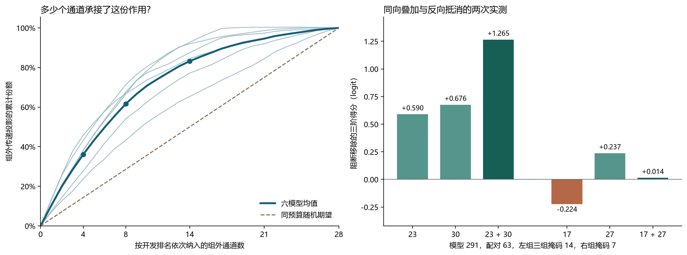

# 末层其余 28 个通道怎样承接、增强和抵消上游作用？

上一轮发现，最后一个残差块第一处 ReLU 的四个通道对输出的作用，有 **72.63%** 的有符号投影经末层预选四通道以外的 28 个通道表达。本轮逐个阻断这 28 个通道，并测完它们的 **378 种双通道组合**。以这 28 个通道承接的作用为 100%，按开发条件选定的前 **4 个**在全强度留出条件上承接 **36.01%**，前 **8 个**承接 **61.61%**，前 **14 个**承接 **83.17%**。具体编号随模型而变。末层联合阻断的得分变化等于单独阻断变化的带符号和，方向相反的通道可以各自作用很大，合计却接近零。[上轮支路定位](dSprites_两层开关阻断后的剩余传递路径_2026-11-26.md) · [逐通道测量](../runs/dsprites_outside_channels_20261126/channel_scores.csv)

## 怎样认出一个通道承接了多少上游作用

沿用 36 张 dSprites 图像、六个同架构的冻结模型及相同的大小与角度划分。每个模型有 18 个开发配对和 18 个留出配对，每对分别改变四种三组组合。全强度和半强度各有 432 条留出记录。沿用前轮的两份四通道名单及八状态中每处各锁 64 个 ReLU 的设置。

Y 是三组同时替换时，供体类与受体类的得分差超出单组和双组预测的部分。记 U 为上游四通道。把 U 的整张激活恢复为空组值，重算末块得到 Yᵤ。两者之差 **F = Y − Yᵤ** 是本轮追踪的上游作用。对于末层任一通道集合 S，在 U 自然和已阻断两种背景中分别阻断 S。四次实测给出两个量。

| 测量对象 | 逐例计算 | 回答的问题 |
|---|---|---|
| 经 S 传递的上游作用 Tₛ | (Y − Yᵤ) − (Yₛ − Yᵤₛ) | 上游四通道造成的改变，有多少从 S 到达输出？ |
| S 对整个三阶输出的作用 Aₛ | Y − Yₛ | 只阻断 S，最终三阶得分实际移动多少？ |

以 O 表示 28 个组外通道的 T 之和。同一模型中，上轮 72.63% 对应的量是 Σ(OF)/ΣF²，六模型等权平均。下文的“组外份额”以 Σ(OF) 作分母，每个通道的份额为 Σ(TⱼF)/Σ(OF)。各模型的 28 个份额逐项相加等于 100%。RMS 描述输出幅度，逐模型计算后再平均。[冻结设计与符号](../experiments/outside_channels_20261126/DESIGN.md)

## 具体是哪些通道

每个模型只用开发端的 72 条全强度记录，按单通道作用在 F 上的有符号投影排序。下面的通道顺序来自开发端，份额和达标所需通道数均来自留出端。完整 28 个排名列在本报告末尾。

| 模型种子末三位 | 排名前四的末层通道 | 四个合计占组外作用 | 达到组外一半所需通道数 | 达到组外八成所需通道数 |
|---|---|---:|---:|---:|
| 291 | 30、23、27、11 | 37.97% | 6 | 12 |
| 292 | 14、3、15、6 | 45.75% | 5 | 13 |
| 293 | 22、24、4、11 | 23.62% | 10 | 20 |
| 294 | 12、5、26、31 | 37.99% | 6 | 11 |
| 295 | 8、13、12、24 | 43.14% | 5 | 10 |
| 296 | 11、15、10、29 | 27.62% | 8 | 16 |

同预算均匀随机选 4 个通道，组外份额的精确期望是 4/28，即 **14.29%**。六个模型的前四均超过这个基准，均值高 **21.73 个百分点**。两组实际随机阻断的份额为 12.76% 和 18.48%。半强度使用同一名单，前 4、8、14 个通道仍分别承接 32.77%、55.16%、76.96%。模型 293 的传递最分散，按同一开发顺序需纳入 20 个通道才能覆盖全强度组外投影的八成。[各模型的覆盖曲线](../runs/dsprites_outside_channels_20261126/cumulative.csv)

## 阻断后，最终输出怎样变化

以下阻断只固定指定末层通道的激活图。每个读数都实际经过模型的分类头。表中“剩余三阶输出”以旧 64 点背景下的 Y 为基准，“剩余上游作用”以 F 为基准。“组外份额”衡量传递方向，“剩余”两列衡量实际 RMS。

| 全强度下阻断的组外通道 | 承接的组外份额 | 占完整上游作用的有符号投影 | 剩余三阶输出 RMS | 剩余上游作用 RMS |
|---|---:|---:|---:|---:|
| 排名第一的单通道 | 10.22% | 7.27% | 94.79% | 92.78% |
| 前 2 个 | 19.92% | 14.16% | 89.76% | 86.08% |
| 前 4 个 | **36.01%** | **25.69%** | **82.37%** | **75.08%** |
| 前 8 个 | 61.61% | 44.28% | 69.51% | 58.38% |
| 前 14 个 | 83.17% | 60.01% | 55.90% | 44.38% |
| 全部 28 个 | 100.00% | 72.63% | 27.80% | 29.02% |

以组外前四为例，阻断使整个三阶输出移动的 RMS 为 **0.682 logit**。全强度 432 条中，**337 条**的绝对三阶输出下降，**95 条**上升。半强度下最终三阶 RMS 剩 82.45%，346 条下降、86 条上升。三组全选端点还保留了低阶成分，同一阻断使该端点的供体−受体得分差移动 **2.394 logit RMS**。若把原末层四通道与新增组外四通道都阻断，全强度最终三阶 RMS 剩 61.35%，上游作用 RMS 剩 49.52%。[各预算和随机对照](../runs/dsprites_outside_channels_20261126/set_scores.csv)

## 哪些通道对彼此增强，哪些产生抵消

对每个模型，在开发记录里分别找出“同号作用重叠量”最大和“反号作用重叠量”最大的一对通道。重叠量取两个作用绝对值中的较小者，以全部开发记录为分母。下表评价两对候选到留出条件后的表现，每个模型 72 条。前两列统计它们承接上游作用 T 时的符号，最后一列统计抵消候选对对整个输出 A 的符号。

| 模型 | 同向候选，T 同号次数 | 抵消候选，T 反号次数 | 同一抵消候选，A 反号次数 |
|---|---|---|---:|
| 291 | 23 + 30，67/72 | 17 + 27，44/72 | 34/72 |
| 292 | 3 + 14，72/72 | 3 + 20，38/72 | 32/72 |
| 293 | 4 + 20，68/72 | 9 + 23，33/72 | 38/72 |
| 294 | 5 + 12，70/72 | 20 + 26，24/72 | 38/72 |
| 295 | 8 + 13，70/72 | 5 + 23，46/72 | 31/72 |
| 296 | 15 + 29，69/72 | 27 + 31，42/72 | 39/72 |

同向候选对在 **416/432** 条全强度记录中承接同号的上游作用，在 **404/432** 条中对整个输出同号。抵消候选对分别在 **227/432** 和 **212/432** 条中反号。在候选抵消对内部，上游传递项的绝对作用中有 **30.11%** 在加总时抵消，对整个输出的作用中有 **27.03%** 抵消。半强度下相应的上游符号次数为同向候选同号 400/432、抵消候选反号 223/432。[全部 378 种通道对的逐模型结果](../runs/dsprites_outside_channels_20261126/pair_scores.csv)

模型 291 的配对 63 给出了两次清楚的实测。通道对在开发端选定，下面从留出记录中各取一个作用明显的三组组合。表内都是最终三阶得分，单位为 logit。

| 通道对与三组掩码 | 阻断前 | 只阻断第一个 | 只阻断第二个 | 两者一起阻断 |
|---|---:|---:|---:|---:|
| 23 和 30，掩码 14 | 6.004 | 5.414 | 5.328 | **4.739** |
| 17 和 27，掩码 7 | 2.238 | 2.461 | 2.000 | **2.224** |

第一例中，23 和 30 分别使得分增加 0.5896 和 0.6758，两者合计 **+1.2654 logit**。其中可追溯到上游四通道的部分分别为 +0.477 和 +0.516。第二例中，17 的输出贡献为 **−0.2235**，27 为 **+0.2374**，联合只留下 **+0.0139 logit** 的净贡献。两者承接的上游部分分别为 −0.118 和 +0.196。每个末层通道还携带上游四通道以外的信号，所以它对整项输出的作用可以和它承接的这部分作用不同。[冻结候选对的逐例得分](../runs/dsprites_outside_channels_20261126/candidate_cases.csv)

在 28 个通道整体中，全强度 **422/432** 条记录同时含有正、负传递项，按各通道的绝对作用加总，有 **28.48%** 在组内抵消。跨案例平均后，168 个模型内通道条目中只有 6 个对 F 的投影为负，分别是模型 294 的 13 号，以及模型 295 的 2、3、11、25、29 号，各自占相应模型组外投影的绝对份额均低于 0.17%。因此逐例看得到明显抵消，而把某一通道固定归为“抑制通道”只能描述很少一部分现象。[模型汇总](../runs/dsprites_outside_channels_20261126/models.csv)

## 联合阻断与单独阻断的核对

末次 ReLU 后是逐通道平均池化和线性分类头。若 i 与 j 是两个不同的末层通道，在相同上游状态下应有 Aᵢⱼ = Aᵢ + Aⱼ。两种强度共实测 **24,192** 个记录级单通道阻断和 **326,592** 个双通道阻断，另有 **17,280** 个预先指定的集合记录。每种配置都测了两个上游背景和八个子集。所有双通道组合均实际经过分类头，全部单通道与 20 个预选集合还逐例在池化前替换完整激活图核对。

对联合与两个单独结果求差，两个上游背景下的三阶输出和端点得分最大偏差为 **3.91 × 10⁻¹⁴ logit**，单独提取传递项 T 后的最大偏差为 **4.27 × 10⁻¹⁴ logit**。三组输入引起的非线性作用已经体现在末层激活里，分类头按符号将各通道的作用相加。CPU 与 CUDA 各自从开发条件生成名单并复跑，名单一致，逐例读数的最大差小于 1.03 × 10⁻¹³ logit。[干预核对](../runs/dsprites_outside_channels_20261126/checks.json) · [联合重建](../runs/dsprites_outside_channels_20261126/reconstruction.json) · [跨设备记录](../runs/dsprites_outside_channels_20261126/replay_comparison.json) · [复现入口](../experiments/outside_channels_20261126/README.md)

## 全部 28 个通道的查阅表

每格为“通道编号（全强度留出端组外份额）”。各列按各自模型的开发排名排列。百分数按两位小数显示。[含单通道阻断得分、半强度与逐项计数的原表](../runs/dsprites_outside_channels_20261126/channel_scores.csv)

| 开发名次 | 模型 291 | 模型 292 | 模型 293 | 模型 294 | 模型 295 | 模型 296 |
|---:|---:|---:|---:|---:|---:|---:|
| 1 | 30（10.57%） | 14（13.13%） | 22（6.90%） | 12（10.43%） | 8（12.91%） | 11（7.36%） |
| 2 | 23（10.21%） | 3（12.68%） | 24（5.71%） | 5（10.12%） | 13（12.63%） | 15（6.88%） |
| 3 | 27（8.50%） | 15（11.84%） | 4（4.96%） | 26（8.52%） | 12（9.45%） | 10（6.92%） |
| 4 | 11（8.70%） | 6（8.09%） | 11（6.05%） | 31（8.91%） | 24（8.14%） | 29（6.46%） |
| 5 | 14（8.18%） | 5（6.28%） | 3（5.63%） | 23（7.96%） | 10（7.64%） | 7（6.99%） |
| 6 | 2（6.86%） | 4（5.79%） | 20（4.52%） | 16（7.63%） | 31（7.24%） | 31（7.04%） |
| 7 | 3（6.57%） | 30（5.09%） | 28（5.39%） | 18（7.16%） | 14（6.39%） | 24（6.29%） |
| 8 | 6（6.98%） | 8（3.96%） | 9（4.02%） | 27（6.88%） | 23（6.93%） | 25（6.18%） |
| 9 | 1（6.81%） | 23（3.29%） | 13（4.80%） | 11（5.81%） | 26（5.01%） | 26（3.95%） |
| 10 | 31（4.00%） | 16（3.60%） | 15（4.30%） | 14（4.97%） | 20（4.17%） | 13（4.57%） |
| 11 | 7（2.32%） | 13（2.49%） | 21（3.60%） | 2（4.62%） | 22（3.22%） | 23（4.00%） |
| 12 | 13（2.06%） | 25（2.75%） | 7（3.31%） | 4（3.75%） | 21（3.63%） | 17（3.83%） |
| 13 | 20（2.92%） | 22（2.75%） | 14（3.47%） | 10（3.58%） | 7（2.75%） | 22（3.51%） |
| 14 | 5（2.79%） | 24（2.70%） | 31（2.66%） | 1（1.62%） | 5（2.60%） | 12（3.17%） |
| 15 | 19（2.67%） | 10（1.89%） | 0（2.78%） | 15（1.24%） | 1（2.61%） | 19（2.11%） |
| 16 | 8（2.58%） | 9（1.50%） | 18（2.63%） | 7（1.23%） | 19（2.26%） | 8（2.05%） |
| 17 | 26（2.21%） | 27（1.52%） | 10（2.89%） | 20（1.16%） | 9（2.13%） | 21（2.66%） |
| 18 | 12（1.05%） | 2（2.02%） | 19（2.44%） | 8（0.79%） | 30（0.32%） | 9（2.70%） |
| 19 | 28（0.53%） | 12（1.58%） | 5（2.69%） | 29（0.76%） | 15（0.19%） | 5（2.54%） |
| 20 | 22（0.42%） | 20（0.96%） | 23（2.53%） | 25（0.74%） | 28（0.12%） | 27（1.77%） |
| 21 | 15（0.42%） | 28（0.89%） | 29（3.12%） | 24（0.72%） | 25（-0.05%） | 28（1.05%） |
| 22 | 0（0.93%） | 18（0.97%） | 27（3.45%） | 0（0.70%） | 18（0.03%） | 3（1.63%） |
| 23 | 16（0.51%） | 21（0.71%） | 17（2.41%） | 30（0.25%） | 17（0.05%） | 2（1.25%） |
| 24 | 17（0.27%） | 17（0.86%） | 25（1.98%） | 19（0.23%） | 0（0.02%） | 14（1.37%） |
| 25 | 21（0.11%） | 31（0.83%） | 26（2.44%） | 3（0.18%） | 3（-0.09%） | 30（1.10%） |
| 26 | 4（0.32%） | 11（0.89%） | 16（2.11%） | 6（0.03%） | 11（-0.04%） | 6（1.37%） |
| 27 | 10（0.25%） | 1（0.65%） | 2（1.81%） | 13（-0.01%） | 29（-0.10%） | 0（0.57%） |
| 28 | 18（0.29%） | 19（0.31%） | 8（1.40%） | 22（0.01%） | 2（-0.16%） | 16（0.69%） |
