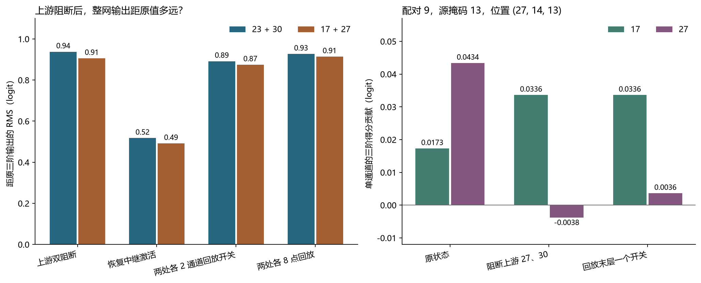

# 模型 291 的末层通道何时同向，何时相互抵消？

在原来的 36 张 dSprites 图像上，模型 291 的两对末层通道显示出不同的传递规律。**23 和 30 的共同变化有一条较集中的上游通路。** 在全强度留出条件中，阻断第二残差块的 29、30 号通道使这对通道的作用方向翻转 14 次，在第三残差块的第一处 ReLU 恢复 13、16 号激活后，这 14 次均回到原方向。**17 和 27 的方向更依赖多通道共同输入。** 阻断第二块的 27、30 号引起 23 次翻转，恢复第三块第一处的 16、20 号挽回其中 11 次。对一个具体配对，单独回放末层 27 号的一个 ReLU 就足以让两条贡献重新同向，但整网三阶得分只移动 0.0074 logit。[上轮末层定位](dSprites_末层组外28通道的承接与抵消_2026-11-26.md) · [逐例得分](../runs/dsprites_pair_origins_20261126/case_effects.csv)

## 一次实验怎样区分方向、幅值和输出

使用冻结模型 202609291、原来的 18 个开发配对和 18 个留出配对。每个配对测试四种三组组合。开发使用全强度 72 条，留出分别测试全强度、半强度各 72 条。每个三组的八个子集状态都沿用上轮的基础干预，即把两层各 64 个指定位置的开关固定为空组状态。下文的原状态和全部比较都在这个背景上定义。

末层通道 j 对最终三阶得分的贡献记作 Aⱼ，等于**供体减受体的分类头权重差 × 通道激活空间平均的三阶差分**。一对通道的两个 A 同号时叠加，反号时抵消。整网三阶得分 Y 是所有 32 个 A 的和。另记录三组全选时的实际供体−受体得分差。文中的“方向”默认指两个 A 的符号关系。上轮第一处四通道 U=(13,16,20,22) 经各末层通道传出的部分另记为 T，单独保存。

用 H 表示第二残差块输出的两个候选通道，用 K 表示第三块第一处 ReLU 后的两个候选通道。在开发端先量 32 个 H 的单独阻断，再量排名前八的 28 个双通道组合，优先选出能改变方向且改变幅度大的 H。维持 H 阻断，把 K 的整张激活按同一图像、同一子集恢复到原值，以两条 A 向原读数恢复的程度筛选 K，同样先测 32 个单通道，再测 28 个双通道组合。留出端使用已经冻结的 H、K、阈值和坐标。以下所有“阻断”均把整张通道激活恢复为空组值。“开关回放”只改变开闭状态，传入该位置的预激活保持干预后的值。[设计与指标](../experiments/pair_origins_20261126/DESIGN.md) · [开发筛选表](../runs/dsprites_pair_origins_20261126/development_channels.csv)

## 哪些上游组合会改变方向

| 全强度，72 条留出记录 | 末层 23、30 | 末层 17、27 |
|---|---:|---:|
| 原状态同向 / 反向 | 66 / 6 | 38 / 34 |
| H，第二块输出 | 29、30 | 27、30 |
| K，第三块第一处 ReLU | 13、16 | 16、20 |
| 单独阻断 H 的第一个 / 第二个，各自翻转次数 | 8 / 9 | 11 / 17 |
| 联合阻断 H，同向转反向 / 反向转同向 | 10 / 4 | 13 / 10 |
| 干预前后成员绝对贡献均 ≥0.001 logit 的翻转 | 6 / 14 | 22 / 23 |
| 恢复 K 的整个激活，原翻转回正 / 新增翻转 | 14 / 5 | 11 / 3 |
| 两组随机 K 恢复的原翻转数 | 1、2 | 0、0 |
| 恢复 K 后，两条 A 的误差 RMS / 恢复前 | 23.08% | 43.64% |

半强度下，H 分别使两对翻转 11 和 14 次，恢复 K 后分别挽回 7 和 9 次。上述“恢复”均针对 H 引起的改变。以两条 A 的联合变化为向量，恢复 K 在回到原读数方向上的投影分别为 **86.36% 和 70.89%**。这两个百分数衡量目标通道对的恢复。整网得分还接收其余 30 个末层通道的输入。[各干预和对照](../runs/dsprites_pair_origins_20261126/arm_scores.csv)

上一轮末层双通道的阻断可直接按符号相加。将同一个检验移到第二块输出，联合阻断 H 后再减去两次单独作用，整网仍留下 **0.194 和 0.181 logit RMS** 的交互，分别对应两对通道的 H。在第三块第一处恢复两个 K 时，相应联合恢复的额外整网作用为 0.027 和 0.037 logit RMS。两层之间的卷积、捷径汇合和 ReLU 给上游组合留下了产生非加和变化的空间。[联合与单独干预差分](../runs/dsprites_pair_origins_20261126/joint_effects.csv)

## 哪些输入条件更容易同向

| 受体 → 供体形状 | 23、30 同向次数 | 17、27 同向次数 | 17、27 的两条读出权重差 |
|---|---:|---:|---|
| 方形 → 椭圆 | 20/24 | 14/24 | −0.4810，+0.3908 |
| 椭圆 → 心形 | 24/24 | 10/24 | −0.3087，−0.9413 |
| 心形 → 方形 | 22/24 | 14/24 | +0.7896，+0.5505 |

23 和 30 在三种形状方向上的两项读出权重差始终同号，因此最终是叠加还是抵消，取决于两通道**三阶激活**是否同号。17 和 27 在方形→椭圆方向的两项权重差异号，两通道的三阶激活同号时对得分的作用反而相反。按源端三组掩码 7、11、13、14 分组，23 和 30 的同向次数依次为 17、16、17、16（每组 18 条），17 和 27 则为 11、8、10、9。[形状、掩码及大小和角度分组](../runs/dsprites_pair_origins_20261126/factor_counts.csv)

将末层两个目标通道的开关固定为空组状态，记读数为 C。自由运行与固定开关的差为 G，真实贡献 A = C + G。当 G 与 C 反号且绝对值超过 C 时，这个通道改变作用方向。全强度下，对 23、30 的两个成员各观察到 13、10 次翻转，6 次二者同时翻转，所以这对通道的符号关系改变了 11 次。17、27 的对应数字为 6、7、1 次，两者的关系也改变了 11 次。[逐例开关项与传入项](../runs/dsprites_pair_origins_20261126/gate_balance_cases.csv)

### 用上游信息判断方向

主实验的方向规则只读三组的上游八状态、空组末层开关和模型权重。在开发端，23、30 的规则选中了 13、16 号经空组斜率送往 30 号的驱动，阈值为 −0.003022 logit。留出时识别 46/66 个同向、3/6 个反向，均衡准确率为 59.85%。17、27 的规则选中了两个分类头权重差的乘积，识别 14/38 个同向、24/34 个反向，均衡准确率为 53.72%。这里的均衡准确率是同向和反向两类召回率的平均值。[冻结阈值](../runs/dsprites_pair_origins_20261126/selection.json) · [预判结果与对照](../runs/dsprites_pair_origins_20261126/rule_scores.csv)

看到两通道规则的表现后，补测了上游覆盖范围。只用开发端计算捷径与 32 个上游第一处通道对**固定末层开关读出**的贡献，并按重建两条固定开关读数的误差依次加入通道。留出时先保留真实捷径，让入选通道变化，其他第一处通道取空组值。下表给出对末层 **17、27** 方向的判断。

| 留出条件 | 全强度同向正确 / 38 | 全强度反向正确 / 34 | 全强度均衡准确率 | 半强度均衡准确率 |
|---|---:|---:|---:|---:|
| 只让中继 16、20 变化，末层开关固定 | 16 | 12 | 38.7% | 37.7% |
| 开发前 8 个上游通道，末层开关固定 | 28 | 25 | 73.6% | 78.1% |
| 开发前 16 个，末层开关固定 | 34 | 27 | 84.4% | 82.1% |
| 同一批 16 个，重算末层开关 | **38** | **32** | **97.1%** | **96.0%** |
| 全部 32 个，末层开关固定 | 35 | 26 | 84.3% | 79.8% |

这 16 个通道依次为 **13、16、22、0、10、4、7、23、24、20、1、5、8、28、12、3**。相同的 16 个上游输入，固定末层开关已能正确判断 61/72 例，随输入重算末层开关后为 70/72。23、30 的少数反向例更难定位，前 16 个上游通道加末层重算识别全强度 3/6 个反向，同向识别 64/66 个。以上比较使用真实的八状态上游激活。[覆盖对照设计](../experiments/pair_origins_20261126/COVERAGE.md) · [两对通道的全部预算](../runs/dsprites_pair_origins_20261126/coverage_scores.csv)

## 哪些 ReLU 开关真的改变了输出

在 H 保持阻断时，把 K 所在通道或末层目标通道的开关逐角恢复到原开闭，输入幅值保留 H 干预后的值。重放两处入选通道内的全部开关，对两条 A 的恢复投影分别为 **22.86% 和 16.55%**。每处仅回放开发端固定的 8 个坐标，投影为 **3.42% 和 0.54%**，分别挽回 2/14 和 0/23 次符号翻转。两份相同通道、开闭频度匹配的随机 8 点对照，对应投影分别为 3.36%／3.05% 和 2.50%／2.32%。固定空间位置的作用随案例而变，恢复 K 的完整激活对总体幅值的影响更大。[逐坐标单点阻断](../runs/dsprites_pair_origins_20261126/site_scores.csv)

下面两个例子沿用 H 阻断后的全部预激活，只在末层指定坐标重放同一案例的原开关。坐标依次为通道、行、列，从零编号。所需最少位置数按每例观测到的开闭差计算，再实际运行这些位置、少一个位置和同预算随机位置。

- **17、27，配对 9，源掩码 13，椭圆→心形。** 原三阶贡献为 (+0.01728, +0.04337)。H 阻断后变为 (+0.03360, −0.00381)。末层位置 **(27,14,13)** 仅在三组全选时额外打开，其预激活由 −1.127 变为 +8.078。把这一个开关恢复为关闭，27 号的三阶贡献就回到 **+0.00362**。整网三阶得分从 **0.26728 变为 0.27470**，全选端点从 4.72652 变为 4.73395，两者都只移动约 **+0.00743 logit**。同预算随机回放的整网变化为 +0.000022 logit。
- **23、30，配对 33，源掩码 14，椭圆→心形。** 原贡献为 (+0.16505, +0.13195)，H 阻断后为 (+0.01216, −0.01079)。30 号的 **(13,16)** 位置在子集 4 和 14 额外打开，**(12,16)** 位置在子集 14 额外打开。只回放第一个位置时 30 号仍为 −0.00422，两处同时回放后为 **+0.00170**。整网三阶得分由 −0.66716 升至 −0.65467，变化 **+0.01249 logit**，全选端点移动 +0.00820 logit。

全强度下，23、30 有 6 次翻转在前后都达到每成员 0.001 logit，回放末层位置能在其中 **5/6** 次把变号成员拉回原符号且达到同样幅度，需要 2–28 个位置。17、27 为 **9/22** 次，需要 1–18 个位置。两组成功案例的同数量随机回放达标数均为 0。半强度相应为 **4/5** 与 **6/10**。这些位置使用了案例本身的开闭信息，与前面在开发端固定的 8 个位置分别评价。[逐例最少位置核验](../runs/dsprites_pair_origins_20261126/local_cases.csv) · [空间坐标与开闭位图](../runs/dsprites_pair_origins_20261126/local_coordinates.csv)

## 最终输出移动了多少

| 全强度 RMS，单位为 logit | 23、30 的上游干预 | 17、27 的上游干预 |
|---|---:|---:|
| H 阻断使目标两通道合计贡献移动 | 0.155 | 0.094 |
| H 阻断使其余 30 个末层通道合计贡献移动 | 0.810 | 0.817 |
| H 阻断使整网三阶输出移动 | **0.938** | **0.906** |
| H 阻断使三组全选端点得分移动 | **1.464** | **1.894** |
| H 保持阻断，恢复 K 激活后整网三阶输出距原值 | **0.518** | **0.492** |
| 相同条件下，全选端点得分距原值 | 0.694 | 0.845 |

各通道贡献在单条记录中按符号相加，表中 RMS 先分别对 72 条记录计算。半强度时 H 的三阶整网改变量为 0.396 和 0.296 logit。原先讨论过的配对 63 同样复现。掩码 14 下，23、30 的原贡献合计 +1.2654，阻断 H 后约 +0.7946，恢复 K 后约 +1.2135，整网三阶得分依次为 **6.004、3.101、4.904**。掩码 7 下，17、27 始终反号，但两者净贡献由 **+0.0139** 升到 **+0.1675**，整网由 **2.238** 升到 **4.174**。恢复 K 后，两者净贡献又缩到约 +0.0027，整网回到 2.519。[逐例目标、其余通道与整网得分](../runs/dsprites_pair_origins_20261126/case_effects.csv)

对上一轮的 U 四通道另实测了全部 16 种阻断组合。以 Shapley 值分摊 U 联合干预后在各末层通道移除的作用，再投影到相应目标上。13 号对 U→23 和 U→30 两项传递的投影分别为 50.99%、65.36%。20 号对 U→17 和 U→27 的投影分别为 −29.29%、+39.52%，显示同一上游通道对这两条传递作用可以方向相反。[四通道全子集分摊](../runs/dsprites_pair_origins_20261126/upstream_four.csv)

原始记录和代码覆盖 144 条留出记录、两对目标、每对 66 个主条件、逐例开关回放和七种上游覆盖预算。结果在 CPU 和 CUDA 上分别从开发筛选开始复跑。[复现命令](../experiments/pair_origins_20261126/README.md) · [跨设备结果](../runs/dsprites_pair_origins_20261126/replay_comparison.json)
