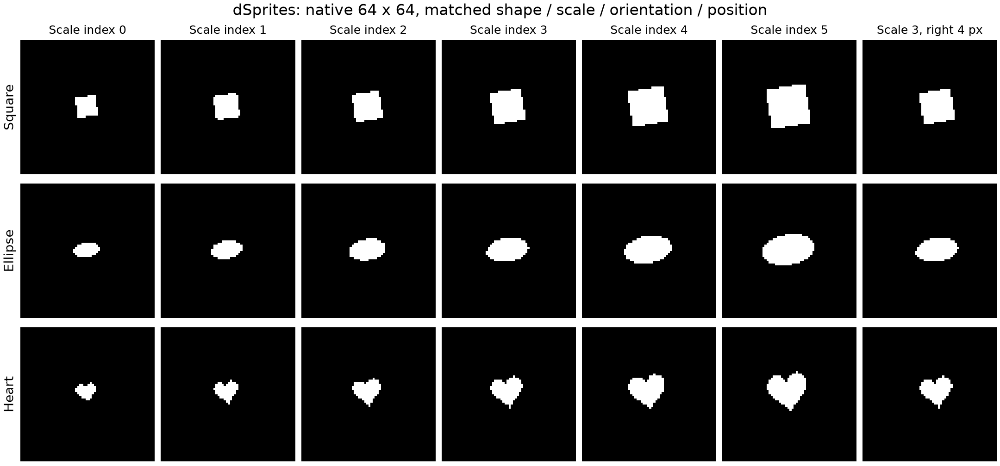
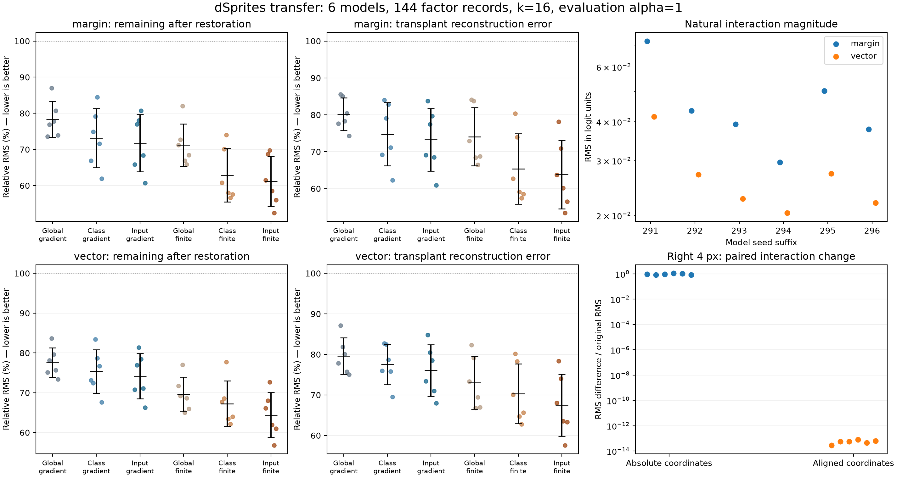

# 使用 dSprites 后，前面的研究还能否继续使用？

2026-09-29｜6个新训练的同架构CNN｜受控因素面板｜完整评价与独立回算已完成

在 dSprites 上，按形状类别选取 16 个中介后，主设置的恢复剩余为 **62.88%**。逐图选取时为 **61.16%**。本轮沿用 Fashion-MNIST 的交互定义、逐层分解与恢复／移植方法，比较不同选择规则。

建议保留原来的研究方向，将问题收紧为：**控制形状类别和空间对应后，哪些因素条件仍需要改变承担组合效应的后层状态？这种中介在不同干预强度下能否保持有效？**

## 1. 这次确实进行了什么实验

使用[官方 dSprites 数据集](https://github.com/google-deepmind/dsprites-dataset)的固定提交，保留原生64×64二值图像，任务设为方形、椭圆、心形三类分类。原数据集有 737,280 张图，本轮取位置索引 8 至 23 的子域。

| 项目 | 本轮设置 |
|---|---|
| 训练／验证 | 24,576／3,072张；按大小、角度、位置整组三形状划分 |
| 开发面板 | 144张，来自训练集，用于选源点与学习固定中介名单 |
| 评价面板 | 144张，3形状×6大小×8角度，位置固定；与开发中心面板使用不同角度 |
| 平移对照 | 原评价图严格右移4像素，无裁剪；另144条配对记录 |
| 模型 | 6个新随机种子的SmallResidualCNN；38,035参数；三残差块；三类读出 |
| 模型能力 | 6个模型的验证准确率和评价面板无干预准确率均为100% |
| 干预对象 | block1的4个空间标量；枚举16组合、24个条件成对差分 |
| 中介与预算 | block2完整输出；共同64候选；16个中介为主，32个为补充 |
| 冻结顺序 | 开发名单冻结→本图半强度选点→所有逐图名单冻结→完整强度与平移评价 |

在 dSprites 上重新训练三分类权重。代码中的 teacher 指接受干预的冻结 CNN。

评价面板有 144 条因素记录，对应 143 张像素不同的图像。最小尺寸的方形在两个角度下生成了相同的像素图，统计时保留了这两条记录。训练、验证和评价划分之间的像素哈希交集为零。评价角度可能出现在训练集的其他位置。

## 2. 旧工作哪些能复用

| 旧工作 | 判断 | 本轮证据或边界 |
|---|---|---|
| 组合干预、条件成对差分 | 已复用 | 对三类、64×64张量成立，保存全部原始组合输出 |
| 仿射传播、基线ReLU门控分解 | 已复用 | 四阶段贡献准确重建输出交互，所有评价输入均核验 |
| 中介恢复／移植 | 已复用 | 与原forward钩子核对；整个可达池的端点检查通过 |
| 固定、逐图、实际单点评分 | 可继续研究 | 方法有效性有新证据，但类别基线和强度变化改变了优势大小 |
| 原CNN结构类型 | 经适配后复用 | 保持卷积残差结构；输入64×64、输出3类、0/1像素；重新训练 |
| 旧局部近似与加速工具 | 保留其原用途 | 近似误差和加速收益见原任务的计时结果 |
| Fashion权重、具体坐标、性能百分比 | 保留为旧任务证据 | dSprites 单独训练模型、选择坐标并评价 |
| “已找到紧凑、稳定、充分的机制” | 仍不成立 | 当前小集合的恢复剩余与移植误差都较大 |

因此，过去的工作没有被推翻。原计算工具、已验证的局部结论、失败案例和代码都继续有用。需要改的是对经验现象的解释范围，以及论文创新点的表述。

## 3. 主要结果：加入类别条件后，逐图选择的额外优势明显缩小

下表为相同64候选、预算16、完整强度α=1、真实类margin目标。每一项先在模型内汇总，再报告6模型均值±样本标准差。**两个指标均越低越好。** 恢复剩余为 60% 表示修补后的交互 RMS 为原值的六成。

| 选择范围与评分 | 恢复后剩余交互 | 移植重建误差 |
|---|---|---|
| 全局固定＋梯度 | 78.33 ± 5.01% | 80.19 ± 4.41% |
| 类别固定＋梯度 | 73.14 ± 8.19% | 74.77 ± 8.59% |
| 逐图选择＋梯度 | 71.78 ± 7.94% | 73.25 ± 8.49% |
| 全局固定＋实际单点干预评分 | 71.20 ± 5.90% | 74.07 ± 7.91% |
| 类别固定＋实际单点干预评分 | 62.88 ± 7.38% | 65.34 ± 9.53% |
| 逐图选择＋实际单点干预评分 | 61.16 ± 6.94% | 63.81 ± 9.29% |

“全局固定”指每个模型内部跨图复用一套集合；“类别固定”指每个模型为每种形状各固定一套。

采用实际单点评分时，全局固定改为类别固定，恢复／移植平均改善8.33／8.73个百分点，6/6模型均改善；再改为逐图选择，只额外改善1.72／1.53个百分点，4/6模型改善。主要收益出现在加入类别条件这一步。

实际干预评分本身仍值得保留：同样逐图、同样16预算，它相对梯度评分在6/6模型上都改善。即便梯度方法可从全部512–640个可达点选择，恢复／移植仍为71.39%／72.90%，高于64候选中实际评分的61.16%／63.81%。这个方法次序与旧Fashion报告中的对应比较不同，进一步说明优势需要逐任务重验。实际评分需要额外的单点修补查询。

每个点代表一个模型，黑线标示六个模型的均值和样本标准差。左侧四图展示两种输出目标；右上为绝对交互大小；右下为配对平移差异。

## 4. 输入差异并没有被类别条件完全解释

真实类margin的方向随标签变化。为检查这一点，另使用去掉类别共同均值的完整logit向量，它不使用真实标签来定义输出方向。

| 实际单点评分，预算16 | 向量恢复剩余 | 向量移植误差 |
|---|---|---|
| 全局固定 | 69.59 ± 4.37% | 73.00 ± 6.53% |
| 类别固定 | 67.26 ± 5.72% | 70.29 ± 7.35% |
| 逐图选择 | 64.42 ± 5.65% | 67.49 ± 7.63% |

向量目标下，逐图比类别固定平均改善2.84／2.80个百分点，6/6模型均改善。

向量目标按中心化的三类 logit 计算。类别固定名单按真实形状分组，共用的 64 个候选中也包含按 margin 评分提名的坐标。

按形状分层后，margin目标的逐图额外改善在心形上较明显：类别固定72.06%／73.34%，逐图65.45%／67.99%，两项均为6/6模型改善；方形与椭圆的平均差距更小。按大小和角度分层的 3,024 条结果见因素统计表。

## 5. 干预强度会改变选择效果

本图逐图选择使用α=.5，主要检验使用α=1。实际评分、预算16时：

| 强度 | 类别固定：恢复／移植 | 逐图：恢复／移植 |
|---|---|---|
| α=.5，选择时强度 | 60.37% / 62.22% | 49.98% / 52.63% |
| α=1，主评价强度 | 62.88% / 65.34% | 61.16% / 63.81% |

半强度下逐图优势较大，变为完整强度后明显缩小。完整强度、预算32时，类别固定为53.14%／56.97%，逐图为53.06%／57.07%，已非常接近。

这提示后续应检验中介对干预幅度的稳定性，而不仅比较某一个强度下谁得分更高。上述结果与非线性门控变化相容，但本轮尚未隔离并证明优势缩小具体由哪些门控变化造成。

## 6. 空间对齐是必要控制

原图严格右移4像素后，继续使用绝对源／中介坐标，margin交互的配对差异RMS约为原交互RMS的0.948倍（6模型均值，范围0.832–1.098）。源点同步右移4像素、中介按步幅2右移2格后，该差异降至2.88×10⁻¹⁴–7.86×10⁻¹⁴。修补交互的配对绝对差也不超过2.58×10⁻¹⁵。

在这个具体平移条件下，对齐后的结果与原图一致到数值误差量级。

## 7. 四个源点的组合干预改变 logit，预测类别保持一致

六模型的主面板margin交互RMS为0.0296–0.0726，明显高于约10⁻¹³的计算核验误差。交互RMS相对源干预效应RMS的模型均值为21.73%±9.05%。

另一方面，六模型、144图、每图15个非空源干预组合，共12,960次主面板完整强度源干预，**没有改变任何预测类别**。

逐图实际评分选择16个中介后，仍留下61.16%的交互RMS，移植误差63.81%；即便使用全部64候选，也仍为50.97%／55.72%。整个可达池能达到数值零，主要验证了完整计算切口与拓扑支持集。

## 8. 下一步应如何推进

**建议保留“神经元组合与跨层机制”的主线，把类别条件与干预强度稳定性纳入机制定义。**

1. 以每类固定集合为强基线，在大小、角度匹配的新因素组合上检验：哪些条件确实需要逐图修正？先用开发数据拟合修正规则，再冻结后评价。
2. 针对半强度到完整强度的落差，检验同一集合跨多个幅度能否同时有效。现有ReLU分解和旧门控计算工具可以提供数学与计算基础，跨层扩展的实现和速度仍需另验。
3. 在大小、角度、位置相同而形状不同的输入之间交换中介，并测量形状得分差。

dSprites适合作为受控机制试验台；原Fashion结果可保留为自然图像上的先导与后续对照。更值得争取的是一个能预测中介何时稳定、何时需要随因素改变，并在新条件下经得起检验的规律。

## 9. 数值与交付核验

- 六个模型共生成24个模型／设置文件夹和4,800条方法分组结果。
- 独立核验38,016个选择集合；以另一种差分矩阵和投影运算顺序回算全部单点评分、逐图指标与模型／类别汇总。
- 运行时逐层、全池端点与半强度重放最大误差1.21×10⁻¹³；独立输出分解回读最大差1.26×10⁻¹⁴；独立教师比率差不超过2.57×10⁻¹⁴。
- 三份旧交付清单的336个文件条目保持原哈希；原注释代码ZIP与既存SHA256一致。
- 初版训练器最后一条完成日志因`utc`重名报错。六个模型、历史和模型冻结文件均已在异常前保存并核验。运行说明记录了日志修复入口。

## 文件入口

- [从原设想到数学与实验的方法说明](dSprites_研究逻辑与复用边界_2026-09-29.md)
- [全部数值表、逐模型结果和补充设置](dSprites_逐项结果表_2026-09-29.md)
- [代码阅读与复现说明](../../docs/REPRODUCTION.md)
- 原始结果汇总（完整研究档案中的文件，未随源码发布）
- 大小与角度分层数据（完整研究档案中的文件，未随源码发布）
- [独立数值核验](../../results/dsprites/independent_audit.json)
- [独立数据来源及划分核验](../../results/dsprites/independent_data_audit.json)
