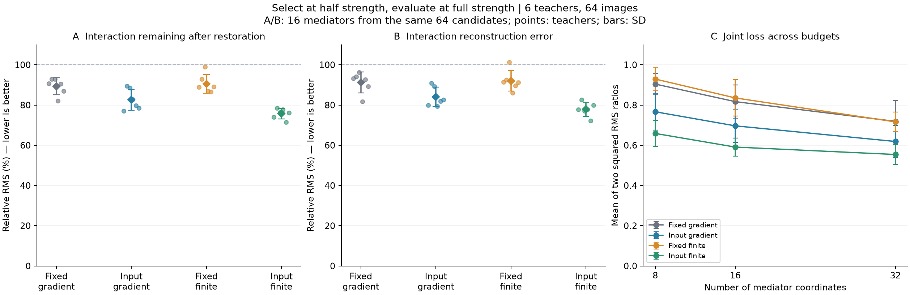

# 自适应中介：第二轮机制验证与旧研究的用途

2026-09-28｜六个已有冻结教师｜同数据集后续探索｜未训练新模型

**逐图选择中介在恢复和移植两项指标上均优于固定梯度名单。**

本轮在相同64候选范围、同样16个中介预算下，逐图实际干预评分得到的完整强度恢复剩余为75.72%、移植误差为77.90%；固定梯度分别为89.32%、91.22%。改善存在，两个残差仍然较大。比率先在各模型内计算，再对六个模型取均值。

## 之前的结果和代码具体还能做什么

| 已有资产 | 在当前研究中的用途 | 结论的适用范围 |
|---|---|---|
| 冻结CNN、检查点和数据划分 | 直接复用，保持模型不变后比较不同机制假设 | 同一架构的 6 个模型分别初始化 |
| 尾部局部响应与组合枚举 | 作为局部加性/低阶参照；保留单独、成对和高阶失效案例 | 原实验中心位置的局部预测误差从 3.56% 降至 1.20% |
| 稳定门控合并与精确修正代码 | 保留为特定尾部结构的精确计算工具、速度基线和数学依据 | 原公式只验证了限定的下游结构；多层 ReLU 的误差界需逐层计算 |
| 第一轮逐层追踪、恢复/移植和核验 | 本轮直接通过import复用；少量新增代码负责选点 | 用代数恒等式核对逐层贡献之和 |
| 第一轮固定中介的弱结果 | 提供可被否定的研究问题；原名单在本轮新批次重评 | 在同一批输入上比较新旧名单 |
| 原中文注释代码包 | 保留作原阶段的阅读和复现入口 | 它代表当时版本；本轮新增代码放在新的独立目录 |

因此，旧实验可以在论文中承担“限定场景下的基线证据、计算工具验证、提出新问题的消融结果”。最终正文是否全部纳入，取决于论文主张；

相关旧报告：局部联合干预（历史研究档案，未随源码发布）、[精确修正数学说明](稳定状态合并与精确修正_数学说明_2026-09-17.md)、[跨层首轮结果](跨层交互_首轮结果_2026-09-28.md)。

## 本轮如何把原因拆开

沿用block1的四个源标量、16种组合、24个条件成对差分，以及block2完整输出的中介切口。训练上下文64张确定候选和固定选择；新批次为官方测试索引1088–1151的64张图，全部6教师和方法复用它们。历史全测试分类结果已知，故这是同数据集后续探索。

先在半强度α=0.5下选点，锁定全部教师、全部输入的名单，再读取完整强度α=1的评价结果。主比较使用相同的64候选名单，来自训练均值的交互/单独效应前32并集并补齐，主预算16。

两条轴分别是：固定集合或逐图集合；基线梯度评分或实际单坐标恢复/移植评分。实际评分为 `mean(I²) − [mean(R_j²)+mean((T_j−I)²)]/2`，即两个平方误差的单坐标改善；不保证多个坐标一起选后的全局最优。

**逐图选择会使用真实标签、该图半强度状态和修补结果，是逐图诊断搜索。** 每张图在半强度下完成选点，完整强度用于评价同一名单。

图A/B：相同候选和k=16，α=1；点为教师，误差线为教师标准差。图C：预先固定的预算。所有指标越小越好。联合损失是两种相对RMS的平方取平均。

## 主结果：逐图选择改善，单纯替换固定评分没有稳定改善

| 方法 | 恢复后剩余交互 | 移植重建误差 | 联合损失 |
| --- | --- | --- | --- |
| 固定集合＋梯度评分 | 89.32 ± 4.22% | 91.22 ± 5.19% | 0.82 ± 0.08 |
| 逐图集合＋梯度评分 | 82.64 ± 5.27% | 84.01 ± 4.88% | 0.70 ± 0.08 |
| 固定集合＋实际干预评分 | 90.55 ± 4.72% | 92.01 ± 5.11% | 0.84 ± 0.09 |
| 逐图集合＋实际干预评分 | 75.72 ± 2.60% | 77.90 ± 3.49% | 0.59 ± 0.04 |

| 预定比较 | 恢复比率差 | 移植误差差 | 恢复／移植／联合损失胜出教师数 |
| --- | --- | --- | --- |
| 逐图集合＋梯度评分 对 固定集合＋梯度评分 | -6.68 百分点 | -7.21 百分点 | 5/6、6/6、6/6 |
| 逐图集合＋实际干预评分 对 固定集合＋实际干预评分 | -14.82 百分点 | -14.11 百分点 | 6/6、6/6、6/6 |
| 固定集合＋实际干预评分 对 固定集合＋梯度评分 | +1.23 百分点 | +0.80 百分点 | 3/6、3/6、3/6 |
| 逐图集合＋实际干预评分 对 逐图集合＋梯度评分 | -6.91 百分点 | -6.10 百分点 | 6/6、6/6、6/6 |

逐图实际评分相对逐图梯度评分，在两项指标上均为6/6教师改善；固定实际评分相对固定梯度，仅3/6改善，均值还略差。

## 候选范围对恢复和移植误差的影响

以下均为k=16、α=1；整个可达池方法的可选范围更大，因此不属于主2×2等范围比较。

| 方法 | 恢复后剩余交互 | 移植重建误差 | 联合损失 |
| --- | --- | --- | --- |
| 固定单独效应排序 | 87.24 ± 5.46% | 89.51 ± 5.33% | 0.78 ± 0.09 |
| 逐图单独效应排序 | 82.84 ± 3.12% | 85.94 ± 3.80% | 0.71 ± 0.06 |
| 四个固定随机组的教师内均值 | 91.70 ± 1.97% | 92.96 ± 2.42% | 0.85 ± 0.04 |
| 上一轮原固定名单 | 86.42 ± 7.29% | 87.70 ± 8.95% | 0.76 ± 0.13 |
| 逐图梯度，整个可达候选池 | 71.43 ± 3.82% | 72.81 ± 4.97% | 0.52 ± 0.06 |

从全部576–640个结构可达点中逐图按梯度选16个，平均恢复剩余71.43%、移植误差72.81%，比在64名单里做逐图实际评分还低。说明共同64名单可能排除了对部分输入有用的点；两种评分方法在相同候选池内比较。

上一轮原固定名单在这批新图上的恢复/移植指标为86.42%/87.70%。本批次按同一组图像比较两种方法。上一批图像的对应均值为87.73%/89.55%。

## 较大中介集合的实测结果

| 方法 | 恢复后剩余交互 | 移植重建误差 | 联合损失 |
| --- | --- | --- | --- |
| 整个64候选名单 | 72.22 ± 5.68% | 76.50 ± 6.60% | 0.56 ± 0.09 |
| 整个结构可达池（576–640） | 0.00 ± 0.00% | 0.00 ± 0.00% | 0.00 ± 0.00 |

整个结构可达池可把恢复交互和移植误差降到数值误差量级，验证了完整切口和支持集实现。64名单仍有较大残差，与名单范围受限相容。

但恢复/移植误差对集合大小并不保证单调：加入新坐标会引入抵消、干扰和门控变化。表中列出全部 64 个候选一起修补时的实测结果。

## 固定补充：预算、强度和逐教师结果

表内每格为“恢复剩余 / 移植误差”，六教师平均。

| α | k | 固定梯度：恢复／移植 | 逐图梯度：恢复／移植 | 固定实际评分：恢复／移植 | 逐图实际评分：恢复／移植 |
| --- | --- | --- | --- | --- | --- |
| 1.0 | 8 | 94.29% / 95.82% | 87.23% / 87.61% | 95.99% / 96.71% | 80.06% / 82.08% |
| 1.0 | 16 | 89.32% / 91.22% | 82.64% / 84.01% | 90.55% / 92.01% | 75.72% / 77.90% |
| 1.0 | 32 | 83.62% / 85.55% | 76.92% / 80.09% | 83.31% / 85.85% | 72.80% / 75.91% |
| 0.5 | 8 | 95.83% / 96.68% | 86.72% / 88.34% | 97.96% / 98.17% | 63.25% / 66.40% |
| 0.5 | 16 | 93.05% / 94.30% | 82.46% / 84.67% | 93.21% / 94.13% | 63.44% / 66.09% |
| 0.5 | 32 | 89.97% / 91.52% | 79.22% / 82.77% | 88.20% / 89.32% | 63.62% / 66.78% |

名单在半强度下选定，完整强度下的改善幅度较小。

下面是主设置α=1、k=16的逐教师结果；格内仍为“恢复剩余 / 移植误差”。

| 教师 | 固定梯度 | 逐图梯度 | 固定实际评分 | 逐图实际评分 |
| --- | --- | --- | --- | --- |
| 202609071 | 90.75% / 93.20% | 77.05% / 79.86% | 88.85% / 91.42% | 74.01% / 77.72% |
| 202609072 | 92.91% / 94.14% | 89.39% / 90.82% | 92.87% / 92.44% | 78.56% / 82.69% |
| 202609073 | 92.87% / 96.30% | 88.55% / 89.35% | 99.04% / 101.36% | 76.25% / 77.07% |
| 202609074 | 81.99% / 81.72% | 82.78% / 79.43% | 86.88% / 85.98% | 77.84% / 77.77% |
| 202609075 | 90.58% / 92.71% | 79.65% / 81.88% | 86.63% / 89.60% | 71.50% / 72.16% |
| 202609076 | 86.84% / 89.23% | 78.40% / 82.70% | 89.03% / 91.29% | 76.18% / 80.00% |

## 不同输入所选中介的重合度

| 动态方法 | 与对应固定集合Jaccard | 不同输入集合间Jaccard |
| --- | --- | --- |
| 逐图集合＋梯度评分 | 0.18 ± 0.01 | 0.16 ± 0.01 |
| 逐图集合＋实际干预评分 | 0.14 ± 0.02 | 0.17 ± 0.01 |

Jaccard=交集数/并集数。集合重合较低只描述排序与选择的变化，也可能受近似分数、并列点或不稳定排序影响。没有单凭低重合推断动态回路。

本轮还存在一个要明确控制的因素：真实标签不同，目标logit对比也会改变。逐图与全局固定的差异同时包含类别间和类别内的变化。各小集合修补后的实测误差见主表。

## 下一步的可检验问题

优先检验：**按类别固定的中介，能否解释逐图选择的改善？同一类别内是否仍需要逐图改变中介？** 在开发数据上为每类固定集合，并与全局固定、逐图选择比较，再冻结规则后用新输入评价。类别固定名单用开发样本拟合，在留出图像上评价。

同时应控制候选范围，优先比较整个结构可达池中的梯度提名与有限干预重评分；必要时加入不依赖真实标签的固定输出方向。这样才能区分目标变化、候选遗漏与有限非线性修补三个因素。

## 实现与证据核验

- 保留6个检查点，没有重新训练；5,000张校准图未进入模型。
- 完美、无效、有害中介评分和零交互控制通过；新单点修补与原网络钩子、旧梯度特征实现核对通过。
- 全部评价图的逐层恒等式、全可达池端点以及半强度重放检查通过，最大差3.058e-14。
- 独立回读核验49,152个有限评分、14,592个选择集合、456条教师方法汇总和29,184条逐输入记录；共193,048项数值比较。教师比率最大差1.709e-13，逐输入绝对量最大差4.915e-15。
- 比率分母小于等于10⁻⁹时置空；核验逐输入比率使用已独立核验的保存分子分母。
- 保存1,572,864个单坐标修补向量用于开发/逐图选择、933,888个成组修补评价向量。实际评分需要额外的单坐标修补查询。
- 原跨层交付90个文件和更早交付136个文件，合计226个文件保持原哈希。

[Activation patching方法研究](https://arxiv.org/abs/2309.16042)讨论指标与修补设计如何影响结论；[AtP*](https://arxiv.org/abs/2403.00745)研究梯度近似可能遗漏的效应。本轮采用这类方法问题检验自己的CNN，没有复现或重新命名这些方法为创新。

## 阅读入口

- [评价前冻结的实验协议](自适应中介_实验协议_2026-09-28.md)
- 运行、数据和代码说明（完整研究档案中的文件）
- 新增选择器代码（完整研究档案中的文件）
- 阶段执行代码（完整研究档案中的文件）
- 原始评价数组（完整研究档案中的文件）
- 全部结果汇总（完整研究档案中的文件）
- 独立核验记录（完整研究档案中的文件）
