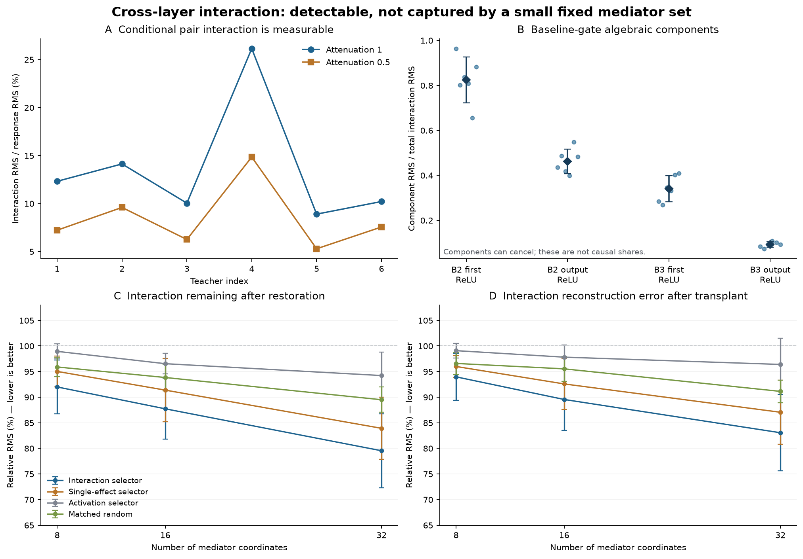

# 跨层交互：第一轮机制验证结果

2026-09-28｜六个已有冻结残差教师｜同数据集后续探索｜没有训练新模型

**已经观察到可测量的跨层组合效应，但当前训练集选出的少量固定中介，尚不足以构成紧凑、稳定的传递机制解释。** 主要预算 16 个坐标时，恢复候选中介后仍剩约 87.73% 的原交互 RMS；仅移植这些中介，重建原交互的相对 RMS 误差仍约 89.55%。恢复和移植都不能按“发现了约 90% 的机制”解释；这里两个比率越小才越好。

候选交互排序在完整强度下优于单独效应排序的教师数，恢复指标为 4/6、移植指标为 3/6。半强度时，k=16 的平均恢复指标反而略差于单独效应排序。这一限制保留在主报告中，不选择性改预算、删教师或改目标。

## 本轮具体推进了什么

与此前只研究最后残差块内部不同，本轮固定从 **block1 完整输出** 施加四个空间坐标的衰减，追踪 block2 和 block3 的四个 ReLU 阶段。它研究同一次干预如何跨层传播，不把不同源层的不同坐标直接比较成“深度效应”。所有受影响的主分支与旁路自然变化。

每图像枚举 16 个组合；6 对源坐标各有 4 个其余坐标背景，共 24 个条件成对差分。主要目标为真实类别 logit 减其他九类平均；完整十维输出并行保存。训练上下文前 64 张用于中介排序，前 512 张用于源坐标选择，4 张既有验证输入用于实现核验。全部六教师的选择统一冻结后，评价固定官方测试索引 1024–1087 的 64 张图像和两种强度。

这一批之前未用于本项目的组合干预，但测试集已经用于历史分类评价；它不是新外部数据集。64 张图在所有教师、方法间复用；24 个差分也不是独立样本。5,000 张校准图仍未进入模型。

共保存 12,288 个自然干预输出向量和 516,096 个恢复/移植输出向量。中介候选池是 block2 输出中结构可达的空间标量，含 576–640 个坐标；原完整层有 6,272 个坐标。本轮没有做完整通道或视觉语义评价。

图：A 的分母是真实源干预响应，C/D 的分母是原交互；它们不是同一种百分比。B 是固定基线门控下的代数分量，不能相加成因果百分比。误差线表示教师标准差，匹配随机组先在每个教师内平均。

## 数学逻辑如何落到实验

对源坐标 i,j 及其余坐标的背景 T，逐层计算 I_l=h_l(Tij)−h_l(Ti)−h_l(Tj)+h_l(T)。源干预本身是独立缩放，因此源层 I 为零。仿射变换满足 I_z=W I_h，残差旁路的对应项同时加入。

每张图的原 ReLU 开关记为 D0，定义每个组合的余项 r=ReLU(z)−D0z；其四项差分 N 满足 I_out=D0 I_z+N。于是可以区分固定门控下的传播和本阶段开关变化造成的修正。递推到输出时，四个阶段的贡献之和准确重建最终交互。

这是一项由网络结构推导的恒等式，不是新定理，也不是独立于基线选择的唯一机制分配。真实机制证据还需要恢复/移植和跨输入检验。

## 结果一：交互可测量，不能把模型整体视作线性

| 强度 | 输出交互 RMS 范围（logit） | 交互 RMS / 干预效应 RMS（六教师均值±SD） |
|---|---|---|
| 1.0 | 0.00426–0.01570 | 13.62 ± 6.41% |
| 0.5 | 0.00127–0.00438 | 8.46 ± 3.45% |

这些绝对效应远大于本轮约 10⁻¹⁴ 量级的数值差异，说明不是舍入噪声。但仍需额外检验其对具体分类行为或视觉概念的作用，不能把非零直接等同于具有语义重要性。这个“交互/效应”比率也不能和上一轮的 1.20% 二阶预测误差直接比较。

## 结果二：多个阶段共同改变交互，第一阶段的输出投影较大

| 阶段 | 投影到输出的分量 RMS / 总交互 RMS（均值±SD） |
|---|---|
| block2 第一次 ReLU | 0.82 ± 0.10 |
| block2 输出 ReLU | 0.46 ± 0.05 |
| block3 第一次 ReLU | 0.34 ± 0.06 |
| block3 输出 ReLU | 0.09 ± 0.01 |

这里把各阶段余项通过后续固定基线门控投影到同一个输出尺度。不同分量可以互相抵消或同向叠加；表中 RMS 比率不可相加，不是“哪一层解释了多少百分比”。它支持跨层计算分解的可行性，尚未唯一识别语义路径。

## 结果三：固定的小中介集合只捕获有限作用

中介位于 block2 完整输出。**恢复**：让源干预照常发生，但将候选 M 还原为本图无干预值；**移植**：让同层其余状态保持无干预值，仅给 M 放入源干预后的值。每种操作在全部 16 个组合上执行，再重算交互。

| 方法，k=16、α=1 | 恢复后剩余交互 / 原交互 | 移植交互误差 / 原交互 |
|---|---|---|
| 交互候选排序 | 87.73 ± 5.96% | 89.55 ± 6.04% |
| 单独效应排序 | 91.38 ± 6.18% | 92.59 ± 4.97% |
| 激活排序 | 96.54 ± 2.02% | 97.81 ± 2.34% |
| 匹配随机组（四组均值） | 93.84 ± 2.58% | 95.53 ± 2.43% |

例如候选恢复比率 87.73% 表示剩余交互 RMS 仍接近原来，不能据此说已阻断大部分传递。移植误差 89.55% 同样表明这 16 个状态不足以在基线背景中重现原交互。候选的平均指标有改善，但相对强基线并不逐教师稳定，也没有新的确认性显著性结论。

| 教师 | 恢复：候选 | 恢复：单独效应 | 恢复：匹配组 | 移植误差：候选 | 移植误差：单独效应 | 移植误差：匹配组 |
|---|---|---|---|---|---|---|
| 202609071 | 92.19% | 93.48% | 92.23% | 94.55% | 92.71% | 93.25% |
| 202609072 | 84.64% | 84.44% | 90.06% | 86.09% | 85.65% | 92.04% |
| 202609073 | 95.37% | 99.45% | 94.02% | 96.66% | 100.52% | 96.38% |
| 202609074 | 80.62% | 96.67% | 97.40% | 80.34% | 95.01% | 97.82% |
| 202609075 | 82.46% | 85.03% | 93.59% | 87.59% | 90.61% | 95.71% |
| 202609076 | 91.09% | 89.20% | 95.75% | 92.06% | 91.01% | 97.99% |

## 固定补充：预算与强度

| α | k | 候选恢复剩余 | 单独效应恢复剩余 | 候选移植误差 | 单独效应移植误差 |
|---|---|---|---|---|---|
| 1.0 | 8 | 92.00% | 95.03% | 93.97% | 95.99% |
| 1.0 | 16 | 87.73% | 91.38% | 89.55% | 92.59% |
| 1.0 | 32 | 79.54% | 83.92% | 83.06% | 87.06% |
| 0.5 | 8 | 92.74% | 93.86% | 94.81% | 96.21% |
| 0.5 | 16 | 88.52% | 88.04% | 91.22% | 91.64% |
| 0.5 | 32 | 82.69% | 82.61% | 86.89% | 86.69% |

预算增加到 32 个时，候选恢复仍剩约 79.54%，移植误差仍约 83.06%。这些预算均在评价前固定，不能事后把最有利一格改称原主检验。半强度下与单独效应排序的差距更弱，不能主张普遍优势。

## 候选与对照的公平性边界

候选按开发数据平均 |原目标梯度×中介条件交互| 排序。它是局部梯度辅助的提名方法，不能保证选出对有限恢复/移植最优的组。单独效应基线采用同样的目标梯度，对齐这一辅助信息。

| 教师 | 结构可达中介数 | 候选与单独排序重合数/16 | 匹配平均距离 | 最大距离 |
|---|---|---|---|---|
| 202609071 | 576 | 4 | 0.300 | 0.648 |
| 202609072 | 640 | 8 | 0.471 | 1.243 |
| 202609073 | 608 | 8 | 0.535 | 1.694 |
| 202609074 | 640 | 7 | 0.351 | 1.055 |
| 202609075 | 608 | 9 | 0.619 | 2.279 |
| 202609076 | 640 | 12 | 0.460 | 1.188 |

匹配距离来自开发数据激活大小与单独效应两个特征的标准化 log1p 空间。部分最大距离较大，因此“匹配随机组”只是近似对照；不能声称完全排除了主效应、激活或其他因素。候选与单独效应组也存在重叠。本轮选择固定于教师、跨输入复用，尚未测试按输入条件变化的中介。

## 数值核验与可复核记录

- 四个已知答案控制通过：加性零交互、阈值两两交互、背景相关三阶作用、隐藏交互在读出处抵消。
- 六教师各四张验证图上，原模型钩子、逐层展开、恢复/移植、空/全中介、零强度和自动微分投影检查通过；最大差 3.232e-14。
- 评价期间逐例检查仿射、ReLU 与输出分解；保存数组独立回读的输出分解最大差 1.989e-14。
- 独立核验器使用 24×16 稠密差分矩阵和目标向量内积，回算 16,128 条逐输入记录与 252 条方法汇总，共 163,728 项数值比较。原始量及按已核验分子/分母直接计算的比率最大差 1.900e-13。
- 有 27 次独立比率比较因较小分母放大了舍入差，最大为 3.049e-08。核验器对原始量和保存的除法仍按 10⁻⁹ 检查，并记录独立运算次序的明确舍入界；没有改动研究的分母下限、指标或任何实验结果。极端逐输入比率应与绝对量一起阅读。
- 原研究交付清单中的 136 个文件保持原哈希，原模型和已交付注释包未修改。

## 这如何改变后续问题

当前可以支持“存在可测量的组合效应，且能在指定基线下准确分解其跨层传播”；不能支持“已经找到少量、跨输入稳定的充分中介”，更不能支持唯一语义回路。

下一步应先区分两个解释：**固定中介集合不适配不同输入**，还是**组合效应本身分散，当前小预算/排序方式捕捉不足**。还存在梯度提名不适合有限干预的可能，不能把本轮失败直接归因于网络必然分布式。

合理的下一轮是在开发数据上比较固定集合、输入条件选择与有限干预重评分，固定规则后另用新批次评价；保持预算、源坐标、目标和修补操作一致。只有条件选择确实外推，才进一步构造较小的机制模型。上述新方法本轮尚未实现或运行，也未提前消耗校准集。

跨层连接与干预已有 [GCC](https://arxiv.org/html/2508.01728v1)、[CLA](https://arxiv.org/html/2404.14349v1) 等先例；[activation patching](https://arxiv.org/abs/2309.16042) 已讨论方法选择对结论的影响。真正的[高层因果抽象](https://www.jmlr.org/papers/v26/23-0058.html)还需要明确变量与干预映射。本轮的价值是形成可被否定的机制检验，而不是将这些既有工具重新命名为创新。

## 文件入口

- [冻结实验协议](跨层交互_实验协议_2026-09-28.md)
- 运行与数据入口（完整研究档案中的文件）
- 原始响应与修补输出（完整研究档案中的文件）
- 全部结果汇总（完整研究档案中的文件）
- 逐输入指标（完整研究档案中的文件）
- 独立核验记录（完整研究档案中的文件）
- 中文注释核心实现（完整研究档案中的文件）
- 实验阶段入口（完整研究档案中的文件）
